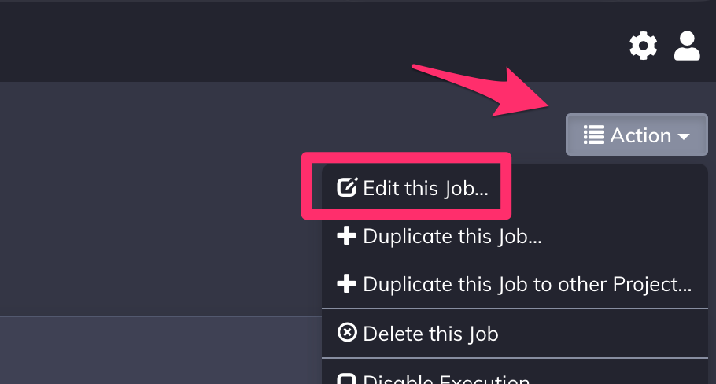
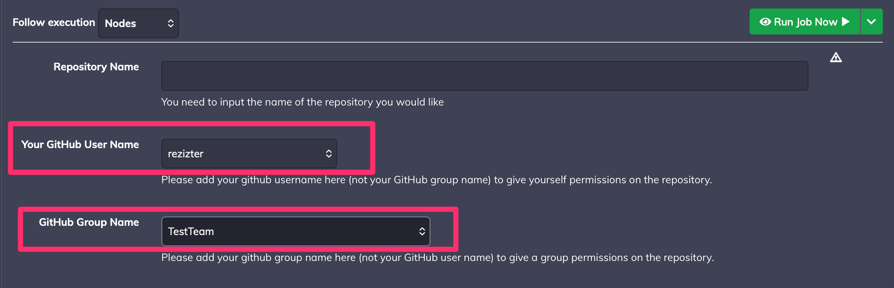

# Rundeck GitHub Options Provider

A zero-dependency Go service that periodically fetches and caches members and teams from a GitHub organization, serving them over HTTP in the exact JSON format expected by Rundeck's **Remote URL** job options provider.

## Features

- **Zero External Dependencies:** Built strictly using the Go standard library (`net/http`, `encoding/json`, `sync`, `flag`).
- **Automatic Pagination:** Follows GitHub REST API RFC 5988 `Link` headers to retrieve organizations of any size.
- **Thread-Safe In-Memory Cache:** Serves concurrent Rundeck UI requests instantly without hitting GitHub API rate limits, refreshing in the background on a configurable TTL.
- **Rundeck-Native Formatting:** Returns `[{"name": "...", "value": "..."}]` with `application/json` headers—mapping human-readable team names to URL-safe team slugs.
- **Observability Included:** Exposes both a JSON `/health` endpoint and a Prometheus-compatible `/metrics` endpoint.

---

## Prerequisites

- **Go 1.22+** (uses method-based routing in `net/http`)
- **GitHub Personal Access Token (PAT):**
  - Classic PAT: Requires the `read:org` scope (to read private organization members and teams).
  - Fine-grained PAT: Requires **Organization permissions → Members (Read-only)**.

---

## Installation & Running

1. **Initialize and build:**
   ```bash
   go mod init github-rundeck-options
   go build -o github-rundeck-options main.go
   ```

2. **Create a <mark>config.json</mark> file:**
   ```bash
   {
     "github_token": "ghp_your_personal_access_token",
     "github_org": "your-organization-name",
     "listen_addr": ":8080",
     "cache_ttl_seconds": 300
   }
   ```

3. **Start the service:**
   ```bash
   ./github-rundeck-options -config config.json
   ```

You may also start the service using flags:
   ```bash
   ./github-rundeck-options -token ghp_xxx -org my-org -addr :8080 -ttl 600
   ```

## Configuration Precedence
Settings are loaded in the following order (later sources override earlier ones):

| Setting	      | Key    		  | Environment Variable | CLI Flag |
| :------------------ | :---------------: | :------------------: | -------: |
| GitHub Token 	      | github_token	  | GITHUB_TOKEN	 | -token   |
| GitHub Organization | github_org	  | GITHUB_ORG		 | -org	    |
| Listen Address      | listen_addr	  | -			 | -addr    |
| Cache Refresh TTL   | cache_ttl_seconds | -			 | -ttl	    |

## HTTP Endpoints

| Method  | Path              | Description 																     |
| :------ | :---------------: | -------------------------------------------------------------------------------------------------------------------------------------------: |
| GET	  | /options/members  | Returns cached organization members (<mark>[{"name": "login", "value": "login"}]</mark>). 						     |
| GET	  | /options/teams    | Returns cached organization teams (<mark>[{"name": "Team Name", "value": "team-slug"}]</mark>).						     |
| GET	  | /health	      | Returns JSON status, cached item counts, last refresh timestamp, and any sync errors.							     |
| GET	  | /metrics	      | Exposes Prometheus metrics (<mark>github_cache_members_total, github_cache_teams_total, github_cache_last_updated_timestamp_seconds</mark>). |
| GET	  | /refresh	      | Forces an immediate out-of-band cache refresh from GitHub.										     |

## Setting Up the Rundeck Remote Options Plugin
Rundeck natively supports dynamic dropdowns via its built-in Remote URL option provider—no third-party .jar installation is required.

1. Open your Rundeck project and navigate to Jobs → Edit Job (or New Job).

2. Go to the Workflow tab and click + Add an option at the top.

3. Set Option Type to Text, enter an Option Name (e.g., github_team or github_member), and optionally provide a Default Value.

4. Scroll down to Allowed Values, select the Remote URL radio button, and enter the service endpoint URL:
For teams: http://<service-host>:8080/options/teams
For members: http://<service-host>:8080/options/members
Leave Authentication Type blank unless you place the service behind an authenticating reverse proxy.
Set the radio button for <mark>Restrictions</mark> to "Enforced from Allowed Values"

5. Click Save on the option, then Save the job. 

6. When running the job, Rundeck will render a searchable dropdown populated from your cache.

