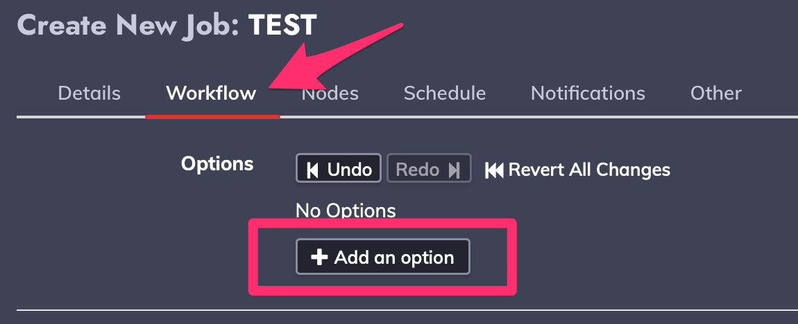
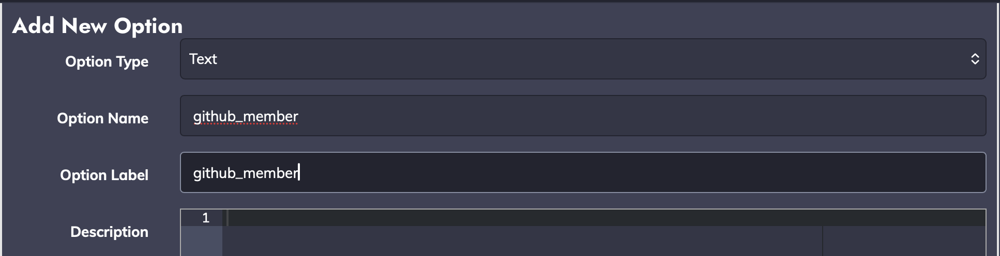
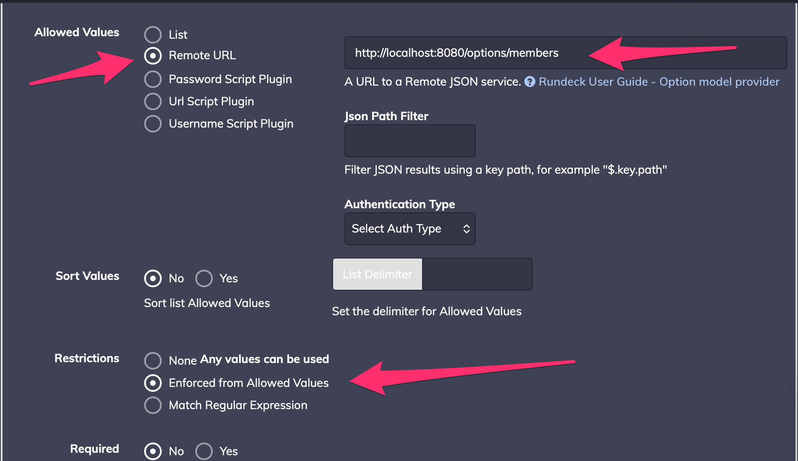
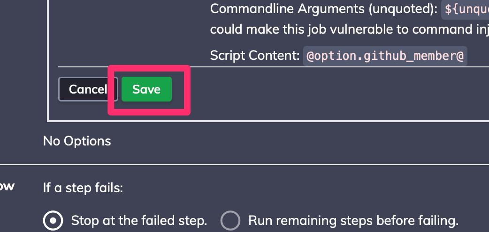

[](https://github.com/rezizter/rundeck-github-options-provider/actions/workflows/ci.yml)
[](https://github.com/rezizter/rundeck-github-options-provider/releases/latest)
[](https://go.dev/doc/go1.25)
[](https://github.com/rezizter/rundeck-github-options-provider?tab=GPL-3.0-1-ov-file)
# Rundeck GitHub Options Provider

A zero-dependency Go service that periodically fetches and caches members and teams from a GitHub organization, serving them over HTTP in the exact JSON format expected by Rundeck's **Remote URL** job options provider.

## Features

- **Zero External Dependencies:** Built strictly using the Go standard library (`net/http`, `encoding/json`, `sync`, `flag`).
- **Automatic Pagination:** Follows GitHub REST API RFC 5988 `Link` headers to retrieve organizations of any size.
- **Thread-Safe In-Memory Cache:** Serves concurrent Rundeck UI requests instantly without hitting GitHub API rate limits, refreshing in the background on a configurable TTL.
- **Rundeck-Native Formatting:** Returns `[{"name": "...", "value": "..."}]` with `application/json` headers—mapping human-readable team names to URL-safe team slugs.
- **Observability Included:** Exposes both a JSON `/health` endpoint and a Prometheus-compatible `/metrics` endpoint.
- **Multi-OS Ansible Deployment:** Includes a hardened `systemd` Ansible role tested with Molecule & Testinfra across **Amazon Linux 2023**, **Rocky Linux 9**, **Ubuntu 22.04**, **Ubuntu 24.04**, and **Debian 12**.

---

## Repository Structure

```text
.
├── main.go                              # Go HTTP service & GitHub API cache
├── main_test.go                         # Unit & mock pagination tests
└── deploy/
    └── ansible/
        ├── requirements.txt             # Ansible, ansible-lint, Molecule & Testinfra deps
        └── roles/
            └── github_rundeck_options/  # Multi-OS systemd deployment role + Molecule suite

## Prerequisites

- **Go 1.22+** (uses method-based routing in `net/http`)
- **GitHub Personal Access Token (PAT):**
  - Classic PAT: Requires the `read:org` scope (to read private organization members and teams).
  - Fine-grained PAT: Requires **Organization permissions → Members (Read-only)**.
- **Ansible 2.14+** (if deploying via the included Ansible role)

---

## Installation & Running

1. **Initialize and build:**
   ```bash
   go mod init github-rundeck-options
   go build -o github-rundeck-options main.go
   ```

2. **Create a <mark>config.json</mark> file:**
   ```bash
   {
     "github_token": "ghp_your_personal_access_token",
     "github_org": "your-organization-name",
     "listen_addr": ":8080",
     "cache_ttl_seconds": 300
   }
   ```

3. **Start the service:**
   ```bash
   ./github-rundeck-options -config config.json
   ```

You may also start the service using flags:
   ```bash
   ./github-rundeck-options -token ghp_xxx -org my-org -addr :8080 -ttl 600
   ```

## Configuration Precedence

Settings are loaded in the following order (later sources override earlier ones):

| Setting	      | Key    		  | Environment Variable | CLI Flag |
| :------------------ | :---------------: | :------------------: | -------: |
| GitHub Token 	      | github_token	  | GITHUB_TOKEN	 | -token   |
| GitHub Organization | github_org	  | GITHUB_ORG		 | -org	    |
| Listen Address      | listen_addr	  | -			 | -addr    |
| Cache Refresh TTL   | cache_ttl_seconds | -			 | -ttl	    |

## HTTP Endpoints

| Method  | Path              | Description 																     |
| :------ | :---------------: | -------------------------------------------------------------------------------------------------------------------------------------------: |
| GET	  | /options/members  | Returns cached organization members (<mark>[{"name": "login", "value": "login"}]</mark>). 						     |
| GET	  | /options/teams    | Returns cached organization teams (<mark>[{"name": "Team Name", "value": "team-slug"}]</mark>).						     |
| GET	  | /health	      | Returns JSON status, cached item counts, last refresh timestamp, and any sync errors.							     |
| GET	  | /metrics	      | Exposes Prometheus metrics (<mark>github_cache_members_total, github_cache_teams_total, github_cache_last_updated_timestamp_seconds</mark>). |
| GET	  | /refresh	      | Forces an immediate out-of-band cache refresh from GitHub.										     |

## Setting Up the Rundeck Remote Options Plugin

Rundeck natively supports dynamic dropdowns via its built-in Remote URL option provider—no third-party .jar installation is required.

1. Open your Rundeck project and navigate to Jobs → Edit Job (or New Job).

2. Go to the Workflow tab and click + Add an option at the top.

3. Set Option Type to Text, enter an Option Name (e.g., github_team or github_member), and optionally provide a Default Value.

4. Scroll down to Allowed Values, select the Remote URL radio button, and enter the service endpoint URL:
For teams: http://<service-host>:8080/options/teams
For members: http://<service-host>:8080/options/members
Leave Authentication Type blank unless you place the service behind an authenticating reverse proxy.
Set the radio button for <mark>Restrictions</mark> to "Enforced from Allowed Values"

5. Click Save on the option, then Save the job. 

6. When running the job, Rundeck will render a searchable dropdown populated from your cache.


## Systemd Script

To run the Go service as a background daemon on Red Hat-based distributions (RHEL, Rocky Linux, AlmaLinux, Fedora), configure a systemd unit file along with a dedicated non-privileged system user and restricted configuration file permissions.

1. Build and Install the Binary & Config:
```bash
# Build the binary
go build -o github-rundeck-options main.go
sudo install -m 0755 github-rundeck-options /usr/local/bin/github-rundeck-options

# Create a dedicated system user with no login shell
sudo useradd --system --no-create-home --shell /sbin/nologin rundeck-gh

# Create config directory and restrict permissions (protects github_token)
sudo mkdir -p /etc/github-rundeck-options
sudo cp config.json /etc/github-rundeck-options/config.json
sudo chown -R root:rundeck-gh /etc/github-rundeck-options
sudo chmod 0750 /etc/github-rundeck-options
sudo chmod 0640 /etc/github-rundeck-options/config.json
```

2. Systemd Unit File:
Create <mark>/etc/systemd/system/github-rundeck-options.service</mark> with hardened security directives suited for RHEL-based systems:
```bash
[Unit]
Description=Rundeck GitHub Organization Options Provider
Documentation=https://github.com/your-org/github-rundeck-options
After=network-online.target
Wants=network-online.target

[Service]
Type=simple
User=rundeck-gh
Group=rundeck-gh
ExecStart=/usr/local/bin/github-rundeck-options -config /etc/github-rundeck-options/config.json
Restart=on-failure
RestartSec=5s

# Hardening & Sandboxing
NoNewPrivileges=yes
ProtectSystem=strict
ProtectHome=yes
PrivateTmp=yes
ProtectKernelTunables=yes
ProtectControlGroups=yes
RestrictRealtime=yes

# Logging to journald
StandardOutput=journal
StandardError=journal
SyslogIdentifier=github-rundeck-options

[Install]
WantedBy=multi-user.target
```

3. Enable, Start, and Configure Firewalld:
```bash
# Reload systemd and start the service
sudo systemctl daemon-reload
sudo systemctl enable --now github-rundeck-options

# Verify service status and logs
sudo systemctl status github-rundeck-options
sudo journalctl -u github-rundeck-options -f

# (Optional) Allow port 8080 through firewalld if Rundeck is on another server
sudo firewall-cmd --permanent --add-port=8080/tcp
sudo firewall-cmd --reload
```
